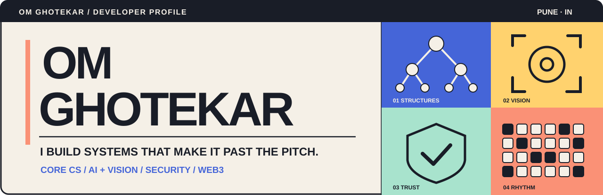
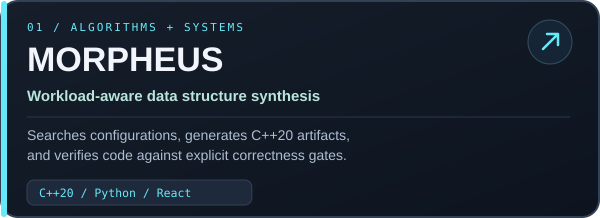
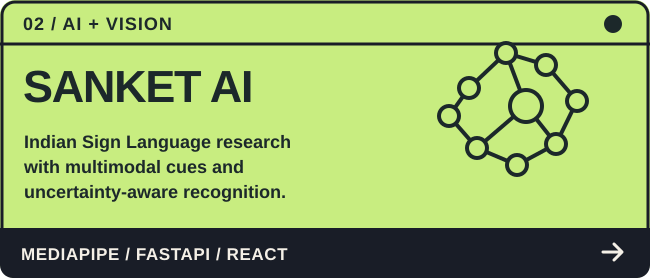
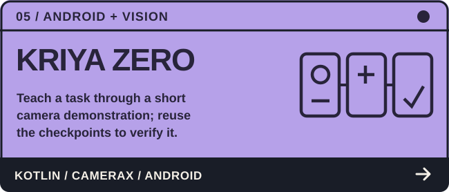
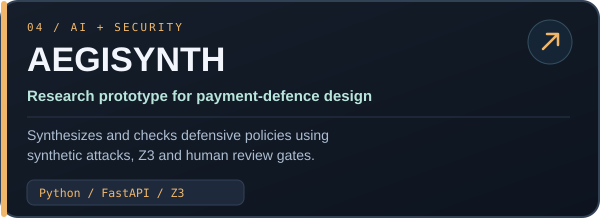
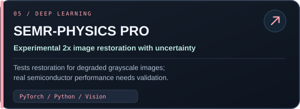
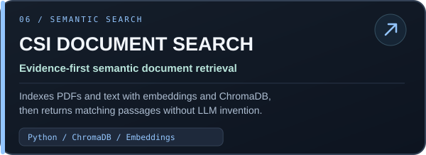
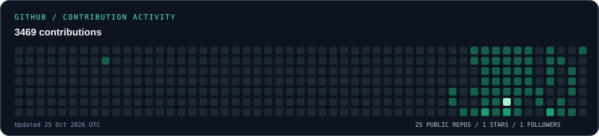

<!-- Om Ghotekar / GitHub profile. Source of visual assets: ./assets. -->

 

**Building intelligent systems. Designing useful experiences. Learning in public.**

`AI / ML` &nbsp; · &nbsp; `Computer Vision` &nbsp; · &nbsp; `Full-stack Engineering` &nbsp; · &nbsp; `Developer Tools` &nbsp; · &nbsp; `Creative Technology`

---

### `01 / about-me.md`  👋

I'm **Om Ghotekar (Omiiii)**, a **B.Tech Computer Science & Engineering (AI & ML)** student at **Vishwakarma Institute of Technology, Pune** (2025–2029).

I enjoy the intersection of **algorithms, AI, software engineering and design**. I work on applied prototypes, from multimodal vision and Android apps to developer tooling and AI-assisted engineering. My approach: **build the smallest useful version, verify what actually works, and iterate**.

<table><tr>
<td width="50%" valign="top">

**🔭 Building & exploring**
- Workload-aware data structures and optimization
- Multimodal computer vision and on-device intelligence
- Trustworthy AI prototypes with explicit evaluation

</td>
<td width="50%" valign="top">

**⚡ Beyond the terminal**
- Full-stack and Android product experiences
- Visual storytelling and UI/UX
- Hackathons, student communities and peer learning

</td>
</tr></table>

### `02 / selected-builds`  🚀

*Selected **public** repositories. Click a card to view code, setup instructions, and current limitations.*

<table>
<tr><td width="50%" valign="top"></td><td width="50%" valign="top"></td></tr>
<tr><td width="50%" valign="top"></td><td width="50%" valign="top"></td></tr>
<tr><td width="50%" valign="top"></td><td width="50%" valign="top"></td></tr>
</table>

<b>More work worth exploring</b>

- **[SkillSwap Campus](https://github.com/omghotekar01-dotcom/SkillSwap)** — React / Node.js student learning-resource and peer-service prototype.
- **[SafeShell++](https://github.com/omghotekar01-dotcom/SafeShell-)** — command-impact prediction research with heuristics; not an execution sandbox.
- **[LeetCode practice](https://github.com/omghotekar01-dotcom/Leetcode)** — algorithm and problem-solving exercises.
- **[My other public repositories](https://github.com/omghotekar01-dotcom?tab=repositories&type=public)** — experiments, prototypes and coursework.

### `03 / toolbox`  🛠️

**Languages:** Python · C++ · Java · JavaScript · TypeScript · Kotlin · SQL

**App & backend:** React · Vite · Node.js · Express · FastAPI · REST / WebSockets · Android / CameraX

**AI & data:** PyTorch · OpenCV · MediaPipe · embeddings · ChromaDB · MongoDB · SQLite · MySQL

**Workflow & design:** Git · GitHub Actions · Docker · Figma · responsive UI

These tools reflect hands-on exploration across different projects; they are not a claim of equal mastery.

### `04 / github-pulse`  📈

Activity visuals are generated from GitHub's data by <a href="./.github/workflows/profile-activity.yml">this scheduled workflow</a>. For definitive counts, see the <a href="https://github.com/omghotekar01-dotcom?tab=overview">GitHub contribution graph</a>. GitHub may take a little time to render SVG updates.

### `05 / campus-and-community`  🎓

**VIT Pune** · B.Tech CSE (AI & ML) · 2025–2029

I enjoy contributing beyond code: student representation, technical communities, workshops and creative initiatives.

- Student Representative (CR), SY CSE AIML-D
- MLSC Coordinator; Secretary, SIG Reality Spectra (AR/VR & multimedia)
- Secretary, SIG Training & Workshop; EMS Technical Domain
- Community President, Adya AI
- Previously: VEDC Multimedia & Design Volunteer (2025–26)

**Learning in the wild:** hackathons, CTFs, technical workshops, and hands-on problem solving. Past participation includes **Monad Blitz Pune V3**, **HackNIMA 2026**, **Kurukshetra 2.0**, **Samarthya 2026** and **SecLeaf Q2 CTF**.

<b>Certifications & learning</b>

- Artificial Intelligence and Machine Learning — Skillsoft (Mar 2026)
- Computer Vision: AI & Computer Vision — Skillsoft (Mar 2026)
- Fundamentals of AI & ML — Skillsoft (Mar 2026)
- Blockchain Basics — Cyfrin Updraft (Mar 2026)

<a href="https://www.linkedin.com/in/om-ghotekar-omiiii/">View education, current roles and credentials on LinkedIn.</a>

### `06 / beyond-code`  🎨

Through **[OMIO STUDIO](https://omio-studio.vercel.app/)**, I also explore **visual identity, campaign design, social creatives, websites and interactive digital experiences**. These include independent concept projects and visual experiments.

**Have an idea involving AI, developer tools, full-stack systems or design?**

[**Connect on LinkedIn**](https://www.linkedin.com/in/om-ghotekar-omiiii/) &nbsp; · &nbsp; [**Explore the portfolio**](https://omio-studio.vercel.app/) &nbsp; · &nbsp; [**Browse repositories**](https://github.com/omghotekar01-dotcom?tab=repositories)

 

Build. Test. Learn. Improve. Repeat. ✦ Made with intent by Om Ghotekar.

