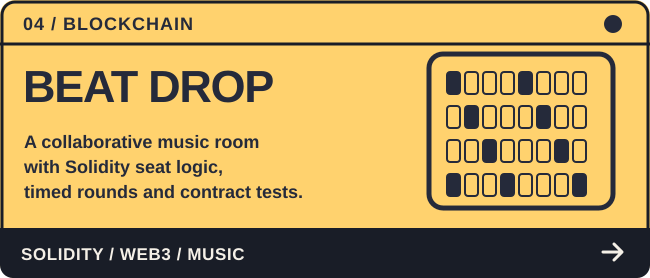
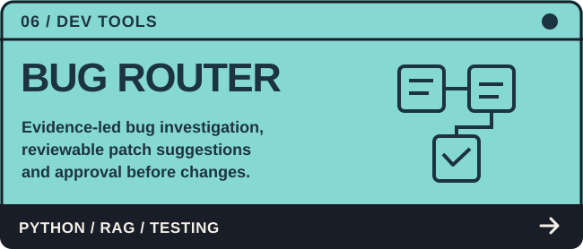
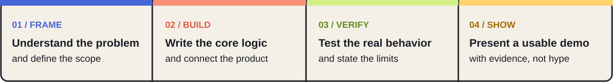

### Student developer · AI/ML · Software engineering · Creative technology

B.Tech in Computer Science &amp; Engineering (AI &amp; ML) at **VIT Pune** · Pune, India

[**LinkedIn**](https://www.linkedin.com/in/om-ghotekar-omiiii/) &nbsp;·&nbsp; [**Portfolio**](https://omio-studio.vercel.app/) &nbsp;·&nbsp; [**Explore my code**](https://github.com/omghotekar01-dotcom?tab=repositories) &nbsp;·&nbsp; [**X**](https://x.com/omghotekar01) &nbsp;·&nbsp; [**Instagram**](https://www.instagram.com/om_ghotekar_official/)

## A little about me

I'm **Om**. I love the part of a project where an ambitious idea becomes something you can run, test, and explain. I work across **algorithms, applied AI, developer tools, cybersecurity experiments, and full-stack apps** — and I enjoy designing the experience around the code just as much as building it.

My GitHub is a mix of individual experiments, team projects, coursework and hackathon builds. I prefer showing **working code and documented limitations** over unverified numbers or claims.

## Selected work

*Six projects I would start with in a technical interview. Select any card to inspect the repository.*

<table>
<tr>
<td width="50%" valign="top"></td>
<td width="50%" valign="top"></td>
</tr>
<tr>
<td valign="top"></td>
<td valign="top"></td>
</tr>
<tr>
<td valign="top"></td>
<td valign="top"></td>
</tr>
</table>

### Inspect the engineering, not just the pitch

| Project | What to open first |
|:--|:--|
| **[MORPHEUS](https://github.com/omghotekar01-dotcom/prompts---morpheus)** | [C++20 primitives](https://github.com/omghotekar01-dotcom/prompts---morpheus/tree/main/core) · [Tests](https://github.com/omghotekar01-dotcom/prompts---morpheus/tree/main/tests) · [Architecture & evidence](https://github.com/omghotekar01-dotcom/prompts---morpheus/blob/main/README.md) |
| **[SANKET AI](https://github.com/omghotekar01-dotcom/SANKET-AI)** | [Vision and ML pipeline](https://github.com/omghotekar01-dotcom/SANKET-AI/tree/main/ml) · [Documentation](https://github.com/omghotekar01-dotcom/SANKET-AI/tree/main/docs) |
| **[AEGISYNTH](https://github.com/omghotekar01-dotcom/Mastercard-project---AEGISYNTH)** | [Backend and policy flow](https://github.com/omghotekar01-dotcom/Mastercard-project---AEGISYNTH/tree/main/backend) · [Reproducible submission](https://github.com/omghotekar01-dotcom/Mastercard-project---AEGISYNTH/tree/main/submission) |
| **[BEAT DROP](https://github.com/omghotekar01-dotcom/MONAD)** | [Solidity contract](https://github.com/omghotekar01-dotcom/MONAD/blob/main/contracts/BeatDrop.sol) · [Contract tests](https://github.com/omghotekar01-dotcom/MONAD/blob/main/test/BeatDrop.test.cjs) |
| **[KRIYA ZERO](https://github.com/omghotekar01-dotcom/KRIYA-ZERO)** | [Android implementation](https://github.com/omghotekar01-dotcom/KRIYA-ZERO/tree/main/app) · [Architecture](https://github.com/omghotekar01-dotcom/KRIYA-ZERO/tree/main/docs) |
| **[Bug Router](https://github.com/omghotekar01-dotcom/KURUKSHETRA-2.O)** | [Backend](https://github.com/omghotekar01-dotcom/KURUKSHETRA-2.O/tree/main/backend) · [Testing and trust model](https://github.com/omghotekar01-dotcom/KURUKSHETRA-2.O/tree/main/docs) |

## Areas I like working in

| Focus | Explore more |
|:--|:--|
| **Core CS / DSA** | [MORPHEUS](https://github.com/omghotekar01-dotcom/prompts---morpheus), [LeetCode solutions](https://github.com/omghotekar01-dotcom/Leetcode), [Expense Tracker (Python + SQLite)](https://github.com/omghotekar01-dotcom/Expense-Tracker) |
| **AI / ML / Computer Vision** | [SANKET AI](https://github.com/omghotekar01-dotcom/SANKET-AI), [KRIYA ZERO](https://github.com/omghotekar01-dotcom/KRIYA-ZERO), [SEMR-Physics Pro](https://github.com/omghotekar01-dotcom/SEMR-Physics-Pro) |
| **Cybersecurity / Reliability** | [AEGISYNTH](https://github.com/omghotekar01-dotcom/Mastercard-project---AEGISYNTH), [SafeShell++](https://github.com/omghotekar01-dotcom/SafeShell-), [AI Agentic Bug Router](https://github.com/omghotekar01-dotcom/KURUKSHETRA-2.O) |
| **Blockchain / Web3** | [BEAT DROP — Solidity / Monad](https://github.com/omghotekar01-dotcom/MONAD) |
| **Full-stack / Data** | [CivicSignal 360](https://github.com/omghotekar01-dotcom/Sociothon), [SkillSwap](https://github.com/omghotekar01-dotcom/SkillSwap), [VIT Portal](https://github.com/omghotekar01-dotcom/VIT_PORTAL), [Document Search](https://github.com/omghotekar01-dotcom/RAG-csi) |

Some featured projects are research prototypes or team builds. BEAT DROP's public contract deployment is not yet verified in its repository. I avoid presenting simulation results as production validation.

## My toolkit

**Languages** &nbsp; C++ · Python · Java · JavaScript / TypeScript · Kotlin · SQL · Solidity

**Apps and APIs** &nbsp; React · Vite · Node.js · Express · FastAPI · Android / CameraX · WebSockets

**AI and data** &nbsp; PyTorch · MediaPipe · OpenCV · ChromaDB · SQLite · MySQL · MongoDB

**Engineering** &nbsp; Git · GitHub Actions · tests · documentation · Figma

## How I approach a build

Beyond code, I explore branding, editorial design and digital experiences through **[OMIO STUDIO](https://omio-studio.vercel.app/)**. It helps me build projects that are easier to understand and show to people.

I enjoy hackathons and technical collaborations where I can move between **problem-solving, implementation, debugging, and the final demo**.

<b>A little fun: my contribution snake</b>

---

**Have something interesting to build?**

[Connect on LinkedIn](https://www.linkedin.com/in/om-ghotekar-omiiii/) · [Browse my projects](https://github.com/omghotekar01-dotcom?tab=repositories) · [View creative work](https://omio-studio.vercel.app/)

Built with curiosity, tests, and a little too much attention to detail.

