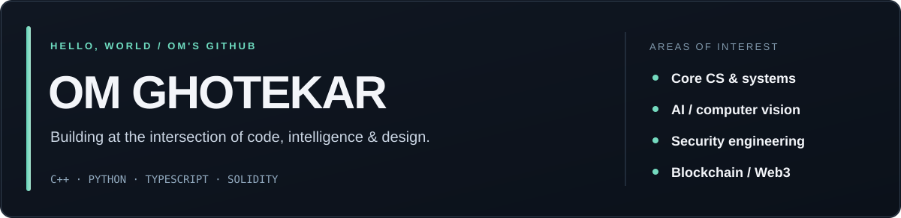

### Software engineering · AI/ML · Product development

**B.Tech Computer Science & Engineering (AI & ML) — VIT Pune**

I enjoy building things that need both engineering depth and a great demo: algorithms that can be tested, AI that can explain its limitations, and products that people can actually use.

---

### 👋 A little about me

I'm **Om Ghotekar**, a student developer based in Pune. My projects span **data structures and optimization, applied AI and computer vision, security-oriented tooling, and blockchain prototypes**.

What I enjoy most is connecting the full process: understanding a problem → building the core logic → creating an interface → testing it → showing a working demo.

I also work on visual design through [OMIO STUDIO](https://omio-studio.vercel.app/), so I care about *how* technical ideas are communicated, not just how they're implemented.

### 🔎 Find the work relevant to you

[**Core CS & DSA**](#-core-cs--dsa) &nbsp;·&nbsp; [**AI / ML & Computer Vision**](#-ai--ml--computer-vision) &nbsp;·&nbsp; [**Cybersecurity & Reliability**](#-cybersecurity--reliability) &nbsp;·&nbsp; [**Blockchain / Web3**](#-blockchain--web3) &nbsp;·&nbsp; [**Full-stack & Data**](#-full-stack--data)

## ⭐ Start with these four

The projects below are selected for **technical discussion in interviews and hackathons**, not for flashy titles. Each links to actual code or a testable artifact.

<table>
<tr>
<td width="50%" valign="top">
<h3>01 · <a href="https://github.com/omghotekar01-dotcom/prompts---morpheus">MORPHEUS</a></h3>

<strong>Core CS / DSA / C++20</strong>

<strong>The problem:</strong> Different workloads need different data structures.

<strong>What the repo explores:</strong> Search over data-structure configurations, generated C++20 implementations, cost models, compilation and correctness checks.

<a href="https://github.com/omghotekar01-dotcom/prompts---morpheus/tree/main/core">C++ core</a> · <a href="https://github.com/omghotekar01-dotcom/prompts---morpheus/tree/main/tests">Tests</a> · <a href="https://github.com/omghotekar01-dotcom/prompts---morpheus">Read the project</a>

</td>
<td width="50%" valign="top">
<h3>02 · <a href="https://github.com/omghotekar01-dotcom/SANKET-AI">SANKET AI</a></h3>

<strong>AI / ML / Computer Vision</strong>

<strong>The problem:</strong> Sign-language communication needs more than a single hand-pose classifier.

<strong>What the repo explores:</strong> Hand, face, body-pose and temporal signals, uncertainty handling, and English/Marathi output in a finite-vocabulary prototype.

<a href="https://github.com/omghotekar01-dotcom/SANKET-AI/tree/main/ml">ML pipeline</a> · <a href="https://github.com/omghotekar01-dotcom/SANKET-AI/tree/main/docs">Documentation</a> · <a href="https://github.com/omghotekar01-dotcom/SANKET-AI">Read the project</a>

</td>
</tr>
<tr>
<td valign="top">
<h3>03 · <a href="https://github.com/omghotekar01-dotcom/Mastercard-project---AEGISYNTH">AEGISYNTH</a></h3>

<strong>AI security / Formal verification</strong>

<strong>The problem:</strong> Novel fraud patterns need defensible responses, not only a score.

<strong>What the repo explores:</strong> Synthetic attack scenarios, candidate defence policies, counterexample-guided refinement, Z3 checks and human review.

<a href="https://github.com/omghotekar01-dotcom/Mastercard-project---AEGISYNTH/tree/main/backend">Backend</a> · <a href="https://github.com/omghotekar01-dotcom/Mastercard-project---AEGISYNTH/tree/main/submission">Reproducible evidence</a> · <a href="https://github.com/omghotekar01-dotcom/Mastercard-project---AEGISYNTH">Read the project</a>

</td>
<td valign="top">
<h3>04 · <a href="https://github.com/omghotekar01-dotcom/MONAD">BEAT DROP</a></h3>

<strong>Blockchain / Solidity / Music tech</strong>

<strong>The problem:</strong> How can collaborators make a beat while tracking each instrument seat's contributions?

<strong>What the repo explores:</strong> A four-seat music experience, a Solidity room contract, transaction flows and automated contract tests.

<a href="https://github.com/omghotekar01-dotcom/MONAD/blob/main/contracts/BeatDrop.sol">Smart contract</a> · <a href="https://github.com/omghotekar01-dotcom/MONAD/blob/main/test/BeatDrop.test.cjs">Contract tests</a> · <a href="https://github.com/omghotekar01-dotcom/MONAD">Read the project</a>

Testnet-oriented prototype; public deployment is not yet verified in its documentation.

</td>
</tr>
</table>

## 🧭 Explore by engineering track

### 🧠 Core CS & DSA

**Interested in algorithms, complexity, memory, data structures, and correctness?**

| Repository | What you can examine |
|:--|:--|
| [**MORPHEUS**](https://github.com/omghotekar01-dotcom/prompts---morpheus) | Robin Hood hashing, B+ trees, tries, beam search, workload optimization and generated C++20 verification |
| [**LeetCode / DSA practice**](https://github.com/omghotekar01-dotcom/Leetcode) | Solutions covering arrays, hashing, two pointers, sliding windows, dynamic programming and more |
| [**Expense Tracker**](https://github.com/omghotekar01-dotcom/Expense-Tracker) | Python application structure, SQLite persistence, budgets, reports and unit tests |

### 🤖 AI / ML & Computer Vision

**Interested in model pipelines, retrieval, on-device intelligence, or applied research?**

| Repository | What you can examine |
|:--|:--|
| [**SANKET AI**](https://github.com/omghotekar01-dotcom/SANKET-AI) | MediaPipe-based multimodal ISL research, bounded recognition and uncertainty handling |
| [**KRIYA ZERO**](https://github.com/omghotekar01-dotcom/KRIYA-ZERO) | Android CameraX capture, learned visual checkpoints and deterministic task verification |
| [**SEMR-Physics Pro**](https://github.com/omghotekar01-dotcom/SEMR-Physics-Pro) | PyTorch grayscale restoration experiments with an uncertainty output; synthetic training data |
| [**AI Agentic Bug Router**](https://github.com/omghotekar01-dotcom/KURUKSHETRA-2.O) | Evidence-based incident triage, retrieval, bounded patch proposals and human approval |

### 🛡️ Cybersecurity & Reliability

**Interested in defensive design, safe automation, verification or system trust?**

| Repository | What you can examine |
|:--|:--|
| [**AEGISYNTH**](https://github.com/omghotekar01-dotcom/Mastercard-project---AEGISYNTH) | Synthetic fraud simulation, policy validation, Z3, and approval-gated changes |
| [**SafeShell++**](https://github.com/omghotekar01-dotcom/SafeShell-) | Heuristic command-impact prediction and explicit safety limitations (not a sandbox) |
| [**AI Agentic Bug Router**](https://github.com/omghotekar01-dotcom/KURUKSHETRA-2.O) | Reviewable remediation flow, safer source intake and tests-before-claiming-a-fix |

### ⛓️ Blockchain / Web3

**Interested in smart contracts, ownership rules and transaction-driven applications?**

| Repository | What you can examine |
|:--|:--|
| [**BEAT DROP / MONAD**](https://github.com/omghotekar01-dotcom/MONAD) | Solidity contract, four-seat permissions, timed rounds, instrument edits, tipping logic and contract tests |

The blockchain repository documents code and test flows. An independently confirmed live contract address has not been established.

### 🖥️ Full-stack & Data

**Interested in APIs, databases, product workflows or end-to-end delivery?**

| Repository | What you can examine |
|:--|:--|
| [**CivicSignal 360**](https://github.com/omghotekar01-dotcom/Sociothon) | Civic-infrastructure analytics, FastAPI, worker jobs and a React UI using synthetic data |
| [**SkillSwap Campus**](https://github.com/omghotekar01-dotcom/SkillSwap) | React, Express, MongoDB and Socket.IO in a student marketplace prototype |
| [**VIT Smart Campus**](https://github.com/omghotekar01-dotcom/VIT_PORTAL) | Next.js, Node/Express and MongoDB application structure |
| [**CSI Document Search**](https://github.com/omghotekar01-dotcom/RAG-csi) | Sentence Transformers + ChromaDB semantic PDF/text retrieval (no LLM-generated answers) |

## 🧰 Technical toolbox

| Area | Tools used in projects |
|:--|:--|
| **CS / algorithms** | C++20, Python, Java, DSA, benchmark and test tooling |
| **AI / vision** | PyTorch, MediaPipe, OpenCV, embeddings, vector retrieval |
| **Backend / data** | FastAPI, Express, REST, WebSockets, SQLite, MySQL, MongoDB |
| **Web / mobile** | React, TypeScript, Vite, Android / Kotlin |
| **Blockchain / security** | Solidity, Hardhat, smart-contract tests, Z3, bounded automation |
| **Workflow / creative** | Git, GitHub Actions, Figma, responsive interfaces |

## 🎯 What I'd contribute in a hackathon

- **Technical build:** implement backend endpoints, integrate UI and APIs, work on algorithms, ML features or contract logic depending on the challenge.
- **Engineering discipline:** create a reproducible setup, test critical paths, document what works, and separate working features from simulated demonstrations.
- **Product thinking:** translate a problem statement into a usable workflow with a clear user journey.
- **Presentation:** make the demo understandable to judges, communicate trade-offs and explain what the code actually proves.

I enjoy problem statements in **accessibility, AI-assisted development, cybersecurity, developer tools, civic technology and Web3**. Several linked projects were built collaboratively; repository ownership should not be taken as a claim of sole authorship.

<b>One more thing: the contribution snake 🐍</b>

 

---

<b>Have a challenging idea or looking for a teammate?</b>

[LinkedIn](https://www.linkedin.com/in/om-ghotekar-omiiii/) · [GitHub](https://github.com/omghotekar01-dotcom) · [X](https://x.com/omghotekar01) · [Instagram](https://www.instagram.com/om_ghotekar_official/) · [OMIO STUDIO](https://omio-studio.vercel.app/)

Building, experimenting and learning — one project at a time.

